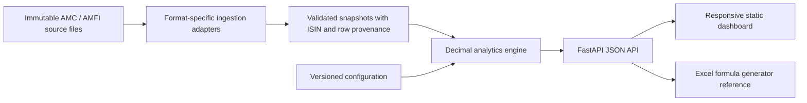

# FactSheetAI — Overlap and Drift Detector

FactSheetAI compares mutual-fund equity portfolios using disclosed ISINs and reported weights. It is a source-backed research prototype: calculations are deterministic, each parsed holding retains its source hash and row span, and unavailable data stays unavailable.

## Current corpus and scope

The frozen research window is July 2025–June 2026. The manifest records 76 official source files (188,908,286 bytes): AMFI NAV and three effective-dated market-cap workbooks; 12 monthly files each for HDFC Large Cap, HDFC Nifty 50 Index, Nippon India Large Cap, SBI Large Cap and Tata Large Cap; and 12 ICICI Prudential factsheet PDFs. Those ICICI PDFs are reference material only: they do not disclose complete holdings with ISINs and aggregate some small positions, so the engine excludes them.

ISIN-level analytics currently cover HDFC, SBI, Nippon India and Tata Large Cap plus HDFC Nifty 50 as a control. The four requested schemes cannot yet be compared as a complete set because ICICI Prudential has no usable ISIN-level disclosure in this corpus. The extra Tata peer is not a substitute for the missing requested fund. The catalog and missing-source report list this limitation. No reserve-option file set has yet been acquired.

Raw AMC and AMFI sources are byte-preserved under `data/raw/`. `data/raw/source_index.json` records official source URLs and source roles; `data/raw/manifest.json` records SHA-256, bytes and dates. Scheme codes and exact Direct Growth names are resolved from the archived AMFI NAV file by `scripts/resolve_schemes.py`. AMFI top-100 lists are matched to each month by their effective date in `config/market_cap_lists.json`.

## Formulas

- **Pairwise overlap:** `Σ min(wAᵢ, wBᵢ)` over common equity ISINs, where each `w` is the disclosed percentage of NAV. The value is percentage points of NAV, not a correlation.
- **Jaccard:** common equity ISIN count divided by the union count. It measures breadth, not weight.
- **Top-N and HHI:** sum the largest N equity weights; HHI is `Σ (wᵢ/100)²`. Its reciprocal is the effective number of equally weighted stocks.
- **Large-cap exposure:** sum holdings whose ISIN is in the AMFI top 100 in force for that disclosure month. The configured mandate floor is 80%; the outside-top-100 amount is reported separately.
- **Turnover:** half the sum of absolute monthly equity-weight changes. **Active share:** half the absolute constituent-weight difference between the portfolio and the supplied benchmark disclosure.
- **Weighted portfolio:** multiply each scheme's equity weight by the user's allocation fraction, then aggregate on ISIN. Outputs are descriptive; they do not model returns or risk.

## Architecture



The engine remains deterministic. Red-flag thresholds are stored in `config/analytics_thresholds.json`; the dashboard can edit and save them. The multi-fund API accepts two to four source-available schemes and rupee allocations. The UI supports month selection, overlap heatmaps, health scores, provenance validation, investment what-if changes, local saved selections, CSV review, and source-backed overlap-reduction simulations.

The Excel report can also research missing fund metadata through the OpenAI Responses API web-search tool. Research is user-triggered from the report panel, searches are restricted to the selected scheme's AMC domain, and only values with an official-domain citation and valid numeric range are included. Field citations are shown in the dashboard and written into the workbook lineage sheet. To enable it, set `OPENAI_API_KEY` in the server environment before starting the app. `FACTSHEETAI_OPENAI_MODEL` optionally overrides the default `gpt-5.5` model. The API key stays on the server; do not put it in browser code or commit it. This uses OpenAI API web-search/model usage and may incur charges. Without a key, local workbook extraction and Excel export continue to work and the report leaves missing values unavailable.

## Add an AMC source adapter

1. Archive the original official source file under `data/raw/amc/<amc>/` and add its URL, retrieval date, disclosure month, size, and SHA-256 to the manifest/source index.
2. Add or verify the Direct Growth scheme code and exact name against `data/raw/amfi/nav.txt`; update `config/schemes.json` with its adapter and source role.
3. Implement an adapter in `factsheetai/ingestion.py` that selects holdings only inside labelled source sections, parses the source disclosure month, preserves original row/sheet locations, and rejects ambiguous or conflicting records.
4. Add fixture-backed parser tests and a source-specific schema note. Never place synthetic observations in production `data/raw/`.
5. Run the full test suite and check month availability before presenting results.

Two independent implementations (pandas merge and pure Python mapping) recalculate overlap. API responses include the match check, selected source URLs, file hashes, parsed time and original row references.

## Run locally

From this folder, with Python 3.11 or newer and dependencies installed:

```powershell
python -m pip install -e ".[dev]"
python -m factsheetai
uvicorn factsheetai.api:app --reload
```

Open `http://127.0.0.1:8000/`. The API also exposes `/health`, `/v1/catalog`, `/v1/analysis`, and generated OpenAPI docs at `/docs`. `data/SCHEMA.md` documents the normalized CSV fallback for manual source files. Production catalog discovery scans only `data/raw/`; synthetic test records are isolated in `tests/fixtures/`.

Quality commands:

```powershell
ruff check .
mypy factsheetai scripts
pytest --cov=factsheetai --cov-report=term-missing
python -m build --no-isolation
```

## Limitations and current gaps

This remains a FastAPI + static HTML/JavaScript application. It does not use Next.js, React, Framer Motion, or 21st.dev; the existing project conventions were retained. The upload review endpoint accepts the normalized CSV schema only. Parsing arbitrary PDF layouts, authentication, database persistence, and a conversational AI layer are not implemented. The optional factsheet lookup uses web search only for the explicitly requested metadata fields; deterministic portfolio calculations and rule outputs remain independent of the model.

The source records do not consistently carry authoritative cash/debt totals, expense ratios, category averages, AUM, or manager names. The app marks these unavailable unless they are present in the workbook or found in a matching-month official AMC source through the optional lookup. Active share and an official benchmark constituent portfolio remain unavailable. Large-cap exposure means membership in the effective AMFI top-100 list; non-members are not silently classified as mid- or small-cap. A normalized upload preview is temporary and is not imported into the production source corpus.

The provided Excel generator is integrated at `factsheetai/excel_report.py` with the supplied JSON schema as reference. The API report route builds current and immediately prior month holdings from the corpus, uses the HDFC Nifty 50 Index Fund only as a clearly labelled benchmark proxy, and marks non-top-100 market caps Unknown. AUM, expense, turnover, cash, manager, category, and lineage fields are extracted from source files or left explicitly unavailable. It recalculates and scans the result with LibreOffice before returning a download. LibreOffice is not installed in the current environment, so the export route returns a clear 503 and formula recalculation/error checking cannot be run here. The supplied sample JSON remains explicitly illustrative and cannot be treated as actual holdings. The registry lists 13 schemes, but only five have monthly files in this corpus, including one index-fund control; ICICI is unavailable at ISIN level. No hand-labelled gold set or completed NAV/AUM reconciliation exists, and the 300 MB genuine-data target is not met (188,908,286 bytes). See `PROGRESS.md`, `METHODOLOGY.md`, `GOVERNANCE.md`, `TRACEABILITY.md`, and `VIVA.md` before presenting findings.

**Educational analysis only; not investment advice.**
